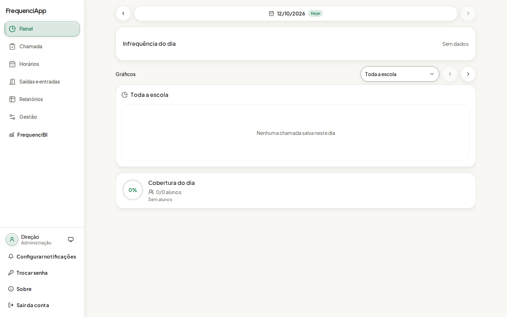
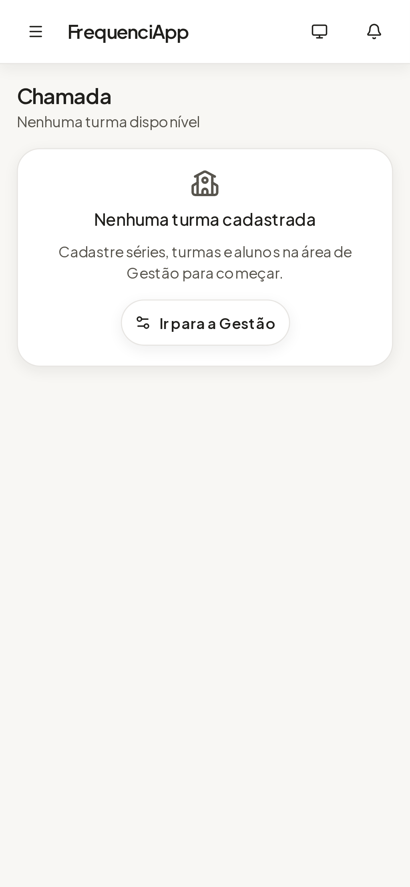
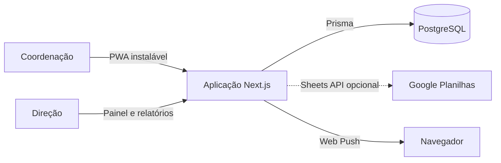

# FrequenciApp

[](https://github.com/eemtijca/frequenciapp/actions/workflows/qualidade.yml)
[](https://github.com/eemtijca/frequenciapp/actions/workflows/testes.yml)
[](https://github.com/eemtijca/frequenciapp/actions/workflows/codeql.yml)
[](LICENSE)

Aplicativo da coordenação escolar: chamada única diária, saídas antecipadas e indicadores da escola. Mobile-first, sem ruído e com o menor número de toques possível entre abrir o app e ter a chamada salva.

Demonstração pública em https://frequenciappjca.vercel.app.

O fluxo segue a prática da coordenação: escolha a turma e o dia, todos começam presentes, toque apenas nos alunos que faltaram, escolha a justificativa quando houver e salve. O Painel mostra a infrequência do dia por série e por turma, a área Saídas e entradas registra quem saiu ou chegou mais tarde com justificativa e quem liberou, e os Relatórios reúnem histórico, grade por período e o resumo por aluno.

<details>
<summary>Sumário</summary>

- [Demonstração](#demonstração)
- [Recursos](#recursos)
- [Stack](#stack)
- [Pré-requisitos](#pré-requisitos)
- [Começando](#começando)
- [Como usar](#como-usar)
- [Configuração](#configuração)
- [Arquitetura](#arquitetura)
- [Testes e qualidade](#testes-e-qualidade)
- [Formas de implantação](#formas-de-implantação)
- [Para agentes de IA](#para-agentes-de-ia)
- [Segurança da implantação](#segurança-da-implantação)
- [Privacidade](#privacidade)
- [Segurança](#segurança)
- [Roadmap](#roadmap)
- [Perguntas frequentes](#perguntas-frequentes)
- [Documentação](#documentação)
- [Contribuindo](#contribuindo)
- [Suporte](#suporte)
- [Créditos](#créditos)
- [Como citar](#como-citar)
- [Licença](#licença)

</details>

## Demonstração

A demonstração pública fica em https://frequenciappjca.vercel.app. Para experimentar localmente com dados sintéticos, siga a seção [Começando](#começando): o Compose cria o administrador e a semente gera séries, turmas, alunos e alguns dias de chamadas e saídas.

<p align="center">
  <a href="docs/imagens/painel-desktop-claro.png">
    <picture>
      <source media="(prefers-color-scheme: dark)" srcset="docs/imagens/painel-desktop-escuro.png">
      
    </picture>
  </a>
  <a href="docs/imagens/chamada-mobile-claro.png">
    <picture>
      <source media="(prefers-color-scheme: dark)" srcset="docs/imagens/chamada-mobile-escuro.png">
      
    </picture>
  </a>
</p>

<p align="center">
  <a href="docs/imagens/README.md">Ver a galeria de capturas</a>
</p>

## Recursos

- **Chamada diária**: turmas por toque, data com navegação por setas, busca por nome, resumo ao vivo e salvamento com rascunho local. A falta pode receber um código de justificativa e vira FJ; o acumulado do aluno aparece na lista e no resumo de faltas.
- **Horários semanais**: consulta por turma e dia ou semana completa, pelo menu após Chamada. A administração configura ordem, início, fim, dias e disciplinas em Gestão > Turmas, sem cadastro de professores.
- **Chamada Parcial**: registro independente por aluno e dia, com turno inteiro ou aulas frequentadas e chave manual "Registrado na Seduc". Correções reabrem a pendência; uma terceira planilha Google recebe os registros após prévia.
- **Entradas atrasadas**: a área Saídas e entradas registra data, horário e motivo da chegada, preservando a turma do registro e a chamada. Envio manual com prévia para aba própria pela Sheets API.
- **Saídas antecipadas**: registro separado da chamada, com momento (aulas, intervalos e almoço), justificativa (tipo do catálogo ou texto escrito), observação e quem libera escolhido em um catálogo da Gestão. A lista das saídas do dia, com remoção para correção, completa a área; o relatório por turma ou por aluno fica em Relatórios.
- **Painel do dia**: gráficos de infrequência por série e por turma, total de faltas (F + FJ), taxa de infrequência com barra de três níveis, cobertura das chamadas e turmas pendentes.
- **Relatórios**: histórico por mês com filtro de série, grade por turma de origem nos modos dia, semana de aula, período e mês, com a coluna acumulada, exportação CSV da turma de origem e relatório por aluno com faltas, justificadas e saídas.
- **Gestão pela administração**: séries, turmas, aulas, alunos e contas da equipe, mais as configurações de recursos, os catálogos de justificativas e de quem libera as saídas, e a cópia de segurança em JSON.
- **Configurações de recursos**: a chamada por aula (chips de aulas e marca S) fica disponível para quando for usada e desligada por padrão; a área de saídas antecipadas pode ser ocultada sem perder registros; os catálogos de justificativas e de quem libera as saídas são editáveis, em ordem alfabética, com código fixo e situação.
- **Proteção contra conflitos**: uma chamada por turma e dia, compartilhada pela coordenação; salvamentos de outro dispositivo são recusados com aviso em vez de sobrescrita silenciosa (controle por revisão em transação serializável).
- **PWA completo**: instala no dispositivo como aplicativo, abre em Chamada ou Painel pelos atalhos, avisa quando a internet cai e atualiza com um toque quando há versão nova.
- **Erros em português**: toda falha de banco ou de API vira mensagem curta e acionável, sem termo técnico.
- **Navegação responsiva**: barra lateral no desktop e menu lateral pelo botão Abrir menu no celular, com as mesmas seções e ações de conta. A troca de visão preserva estado e rolagem; Gestão aparece no menu para a administração.
- **Tema do sistema, claro ou escuro**, interface plana sem desfoque, animações discretas que respeitam a preferência de movimento reduzido e layout pensado para uma mão.
- **Google Planilhas opcional**: frequência, saídas e entradas e Chamada Parcial usam arquivos escolhidos com OAuth e Google Picker, pela Sheets API. A Chamada Parcial exige um terceiro arquivo separado. Há conferência do esquema, prévia obrigatória e releitura antes da escrita. Na frequência e nas saídas, o modo completo, com senha e prazo, permite corrigir divergências e remover apenas o que a integração criou. Não são criadas abas de backup. Consulte [as condições de escrita pela Sheets API](docs/planilha.md).

## Stack

- Next.js 16 (App Router) com TypeScript estrito.
- PostgreSQL 17 com Prisma ORM 7, conexão do runtime em `DATABASE_URL` e conexão do CLI em `DIRECT_URL`, com adaptador oficial `pg`.
- Autenticação própria: scrypt para senhas, sessões opacas em cookies HttpOnly e papéis de administração e coordenação.
- Transações ACID com isolamento serializável e repetição automática em conflitos.
- Tailwind CSS 4 com componentes shadcn/ui personalizados, animações com Motion e gráficos com Recharts.
- Service worker próprio para a experiência instalável e o aviso offline.
- Vitest para testes de unidade e contratos de API.

## Pré-requisitos

- Node.js 20.19 ou superior.
- Docker com Compose no modo recomendado.
- PostgreSQL 17 próprio, como alternativa ao Compose.

## Começando

```bash
cp .env.example .env
# Gere o segredo da sessão e cole no .env:
#   openssl rand -base64 32
docker compose up --build
```

O Compose sobe o PostgreSQL 17, aplica as migrações na partida e inicia o aplicativo em http://localhost:3000. O administrador inicial (primeiro usuário, acesso root de configuração) pode ser criado na partida: basta preencher `ADMIN_EMAIL`, `ADMIN_SENHA` e `ADMIN_NOME` no `.env`. O bootstrap não altera uma conta que já exista, então reiniciar o contêiner não regrava a senha. Para criar ou trocar a senha depois, rode o comando que sempre aplica os valores:

```bash
ADMIN_EMAIL=direcao@escola.br ADMIN_SENHA='uma senha forte' ADMIN_NOME='Direção' \
  docker compose exec app pnpm run criar-admin
```

Com o administrador no dispositivo, o restante (contas da equipe, séries, turmas, aulas e alunos) é configurado pela área de Gestão, sem comandos. Para experimentar com dados sintéticos (nenhum dado real de pessoa), crie também a conta de coordenação de demonstração e aplique a semente, que simula um ano letivo com nove turmas, 35 a 50 alunos por turma, chamadas, faltas, saídas, entradas, parciais e diretores de turma de exemplo:

```bash
CONTA_EMAIL=equipe@escola.br CONTA_SENHA='outra senha forte' CONTA_NOME='Equipe' \
  docker compose exec app pnpm run criar-coordenacao
docker compose exec app pnpm run seed
```

A semente é determinística, idempotente e sem dados reais. Ajuste o volume com `SEED_PERFIL=leve|padrao|pesado`, `SEED_ALUNOS`, `SEED_DIAS`, `SEED_ANO` e `SEED_SEMENTE`; `pnpm run seed:limpar` remove apenas o que ela criou. Os diretores de exemplo entram com `diretor.1a` e `diretor.2b`.

Instruções sem Docker, variáveis de ambiente e demais detalhes em [docs/ambiente.md](docs/ambiente.md). Publicação em [docs/deploy.md](docs/deploy.md).

## Como usar

1. A administração cria as contas da equipe e configura séries, turmas, aulas e alunos.
2. A coordenação abre a Chamada, escolhe a turma e o dia e marca apenas os ausentes.
3. Saídas, entradas e a Chamada Parcial são registradas nas áreas próprias, com justificativa e autoria.
4. O Painel mostra a infrequência do dia, a cobertura das chamadas e as turmas pendentes.
5. Os Relatórios consolidam o histórico e permitem exportar a turma em CSV.
6. Opcionalmente, a escola conecta as planilhas Google para receber os registros.

## Configuração

As variáveis são validadas na partida. As principais:

| Variável        | Papel                                                                |
| --------------- | -------------------------------------------------------------------- |
| `DATABASE_URL`  | Conexão de runtime, com pooler de transação em ambientes serverless. |
| `DIRECT_URL`    | Conexão de sessão para CLI e migrações em banco gerenciado.          |
| `AUTH_SECRET`   | Segredo das sessões e da derivação do par de notificações.           |
| `TZ_APP`        | Fuso usado para resolver o dia corrente e os rótulos de datas.       |
| `PERMITIR_HTTP` | Aceita HTTP sem TLS em rede confiável; padrão `false`.               |
| `GOOGLE_*`      | Integração opcional com as planilhas pela Sheets API.                |
| `PUSH_VAPID_*`  | Par de chaves das notificações Web Push.                             |

A referência completa está em [docs/ambiente.md](docs/ambiente.md).

## Arquitetura

Aplicação Next.js única, com o aplicativo inteiro em `/` e as visões trocadas localmente. A integração com o Google é opcional e desligada por padrão.



As camadas, o fluxo de requisição e as decisões registradas estão em [docs/arquitetura.md](docs/arquitetura.md) e [docs/adr/](docs/adr/).

## Testes e qualidade

| Comando                    | Efeito                                                   |
| -------------------------- | -------------------------------------------------------- |
| `pnpm run format:check`    | Prettier em modo verificação.                            |
| `pnpm run lint`            | ESLint com regras estritas.                              |
| `pnpm run tsc`             | Verificação de tipos sem emissão.                        |
| `pnpm run test:unit`       | Testes de unidade e guarda editorial.                    |
| `pnpm run test:api`        | Contratos de API com o aplicativo no ar.                 |
| `pnpm run test:e2e:docker` | Ponta a ponta na imagem oficial, com o aplicativo no ar. |
| `pnpm run test:pwa:docker` | PWA contra o build de produção.                          |
| `pnpm run capturas:readme` | Regenera as capturas do README em `docs/imagens/`.       |

A convenção das suítes está em [docs/testes.md](docs/testes.md) e [tests/README.md](tests/README.md).

## Formas de implantação

O VPS Linux é o destino de produção do FrequenciApp. A Vercel fica como ambiente de preview ou desligada, sem deploy automático da `main`. A escolha evita dois bancos, duas agendas e duas origens de dados para o mesmo domínio.

O instalador `instalar.sh` é o caminho recomendado em VPS. Ele segue o contrato de [docs/instalador.md](docs/instalador.md), com comandos, flags, JSON e códigos de erro estáveis, e orquestra os scripts de servidor já existentes.

No caminho de nuvem, o build da Vercel apenas gera o cliente Prisma; as migrações são aplicadas pelo workflow de implantação em cada push na `main` ou manualmente com `pnpm run db:deploy`. A agenda de notificações usa o `CRON_SECRET`. As demais formas de publicação estão em [docs/deploy.md](docs/deploy.md) e a implantação em AWS, Azure ou GCP com Terraform está em [docs/implantacao-nuvem.md](docs/implantacao-nuvem.md).

### Instalação rápida em VPS Ubuntu 26.04

Pré-requisitos: VPS com Ubuntu 26.04 LTS, DNS do domínio apontando para o servidor, portas 80 e 443 liberadas no provedor, uma conta com `sudo` e Node.js 24 ou superior no `PATH` para executar `planejar`. O bootstrap só instala o runtime oficial em comandos que alteram o host; o procedimento do Node 24 está em [docs/instalador.md](docs/instalador.md).

```bash
sudo apt-get update
sudo apt-get install -y git curl ca-certificates
sudo git clone https://github.com/eemtijca/frequenciapp.git /opt/frequenciapp
cd /opt/frequenciapp
```

Gravar a senha inicial da administração em um arquivo com modo 600, como `/root/senha-admin`, sem digitar o valor na linha de comando. A tag `vX.Y.Z` é ilustrativa e deve ser substituída pela tag estável publicada no momento da instalação. O fingerprint GPG do exemplo também é fictício.

```bash
sudo ./instalar.sh planejar \
  --perfil simples \
  --canal release \
  --tag vX.Y.Z \
  --dominio frequencia.exemplo.br \
  --email-acme administracao@escola.exemplo.br \
  --email-admin direcao@escola.exemplo.br \
  --proxy caddy \
  --tls acme \
  --arquivo-senha-admin /root/senha-admin \
  --destinatario-gpg 0123456789ABCDEF0123456789ABCDEF01234567 \
  --salvar-config /root/instalador.json \
  --json

sudo ./instalar.sh aplicar \
  --config /root/instalador.json \
  --sim
```

O `--salvar-config` só grava a configuração quando o plano não tem erro bloqueante. Se preferir não criar contas na instalação, use `--pular-contas`; para backup com age, troque `--destinatario-gpg` por `--criptografia age --destinatarios-age <arquivo>`.

Conferir o plano, os avisos e os códigos antes do `aplicar`. O `aplicar` grava a configuração efetiva em `/etc/frequenciapp/instalador.json`, sem segredos. Depois da subida:

```bash
sudo ./instalar.sh situacao --json
sudo ./instalar.sh diagnosticar --json
curl -fsS https://frequencia.exemplo.br/api/saude
```

O domínio, os e-mails e o fingerprint acima são fictícios. O `--seed` não entra no caminho de produção, porque cria massa sintética. As demais flags, como backup e agendador, estão no [contrato do instalador](docs/instalador.md) e no [guia de auto-hospedagem](docs/auto-hospedagem.md).

### Perfis

| Perfil        | Controlador | Dropbox | Uso                                               |
| ------------- | ----------- | ------- | ------------------------------------------------- |
| `simples`     | não         | não     | Escola com VPS e Docker. É o perfil padrão.       |
| `controlador` | sim         | não     | Escola que adota journal, pins e entrada estável. |
| `dropbox`     | não         | sim     | Escola que usa Dropbox para o backup do banco.    |
| `completo`    | sim         | sim     | Escola que adota controlador e Dropbox.           |

Os perfis `controlador`, `dropbox` e `completo` são opt-in e exigem configuração explícita. O perfil `simples` não pode ser bloqueado por artefato do controlador nem depender do Dropbox.

O perfil com controlador exige `--operador-controlador` com uma conta sem privilégio administrativo e usa as entradas estáveis em cron. O perfil Dropbox exige `--config-dropbox`, `--arquivo-token-dropbox`, `--config-rclone` e `--destino`, com arquivos privados e a mesma pasta no rclone e na adoção. O perfil `completo` combina os dois.

### Distribuições suportadas

| Tier | Distribuições                                                                                                          | Tratamento                                                 |
| ---- | ---------------------------------------------------------------------------------------------------------------------- | ---------------------------------------------------------- |
| 1    | Ubuntu 22.04, 24.04 e 26.04; Debian 12 e 13; RHEL, Rocky e Alma 9 e 10; Fedora atual; Arch; openSUSE Leap e Tumbleweed | Plano testado em Docker; aplicação validada em subconjunto |
| 2    | Amazon Linux 2023, Oracle Linux 9 e 10, CentOS Stream, Alpine 3.20 ou superior, Raspberry Pi OS 64 bits                | Melhor esforço, com aviso e fallback                       |
| 3    | 32 bits, sem Bash, WSL, macOS, Windows, sem Docker                                                                     | Recusa com `E_DISTRO`                                      |

### Métodos

| Método                | Quando usar                                            | Comando                                                                                                                                                       | Guia                                          |
| --------------------- | ------------------------------------------------------ | ------------------------------------------------------------------------------------------------------------------------------------------------------------- | --------------------------------------------- |
| VPS simples           | Escola com VPS e Docker, sem os perfis opt-in          | `sudo ./instalar.sh planejar --perfil simples ...` e `sudo ./instalar.sh aplicar --config /root/instalador.json --sim`                                        | [instalador](docs/instalador.md)              |
| VPS controlador       | Escola que adota journal, pins e entrada estável       | `sudo ./instalar.sh aplicar --perfil controlador --operador-controlador <conta> ... --sim`                                                                    | [controlador](docs/controlador-manutencao.md) |
| VPS Dropbox           | Escola que usa Dropbox para o backup do banco          | `sudo ./instalar.sh aplicar --perfil dropbox --config-dropbox <adocao> --arquivo-token-dropbox <token> --config-rclone <rclone> --destino <remoto> ... --sim` | [Dropbox](docs/dropbox-retencao.md)           |
| VPS completo          | Escola que usa controlador e Dropbox                   | `sudo ./instalar.sh aplicar --perfil completo ... --sim`                                                                                                      | [instalador](docs/instalador.md)              |
| Compose manual        | Operador que quer controle manual da pilha             | `cp .env.example .env && docker compose up -d --build`                                                                                                        | [auto-hospedagem](docs/auto-hospedagem.md)    |
| Imagem publicada      | Outro orquestrador, como ECS, Cloud Run ou App Service | `docker pull ghcr.io/eemtijca/frequenciapp:<tag>`                                                                                                             | [deploy](docs/deploy.md)                      |
| Kubernetes            | Cluster Kubernetes com Helm                            | `helm upgrade --install frequenciapp infra/kubernetes/frequenciapp --namespace frequenciapp --set existingSecret=frequenciapp-segredos --set image.tag=<tag>` | [Kubernetes](docs/kubernetes.md)              |
| Vercel ou nuvem       | Preview ou demonstração; a produção fica no VPS        | workflow `implantacao.yml` com `DEPLOY_TARGET` vazio ou `vercel`                                                                                              | [deploy](docs/deploy.md)                      |
| Desenvolvimento local | Desenvolvimento e testes da aplicação                  | `pnpm install --frozen-lockfile` e `pnpm run dev`                                                                                                             | [ambiente](docs/ambiente.md)                  |
| Atualização           | VPS existente, com backup confirmado                   | `sudo ./instalar.sh atualizar --canal release --tag vX.Y.Z --sim`                                                                                             | [instalador](docs/instalador.md)              |
| Backup                | Rotina manual ou antes de atualização                  | `sudo ./instalar.sh backup --sim`                                                                                                                             | [backup](docs/backup-servidor.md)             |
| Restauração           | Recuperação de desastre ou retorno ao banco anterior   | `sudo ./instalar.sh restaurar --do-remoto --sim`                                                                                                              | [backup](docs/backup-servidor.md)             |
| Desinstalação         | Remoção dos serviços, preservando dados                | `sudo ./instalar.sh desinstalar`                                                                                                                              | [instalador](docs/instalador.md)              |
| Canal                 | Troca de `main` para `release` ou fixação de tag       | `sudo ./instalar.sh canal definir release --tag vX.Y.Z --planejar`                                                                                            | [instalador](docs/instalador.md)              |
| Diagnóstico           | Suporte, auditoria e uso por agentes                   | `sudo ./instalar.sh diagnosticar --json`                                                                                                                      | [instalador](docs/instalador.md)              |

As linhas de perfil usam `...` para as flags de domínio, TLS, contas, backup e agendador, que são as mesmas da instalação rápida e estão detalhadas no guia. O perfil com controlador instala as rotinas em cron; o perfil Dropbox mantém o primeiro backup com upload rclone e verificação nativa.

### VPS único de produção

O VPS Ubuntu 26.04 LTS é o único destino de produção. A Vercel fica como preview ou desligada, sem deploy automático da `main`. O corte no repositório começa pelas variáveis de operação:

```bash
gh variable set DEPLOY_TARGET --body servidor
gh variable set AGENDA_EXTERNA --body servidor
gh variable set BACKUP_EXTERNO --body servidor
```

Com esses valores, os workflows de implantação, migração, agenda e backup da nuvem são pulados. O instalador não configura o GitHub nem a Vercel. O checklist e a reversão estão no guia de [auto-hospedagem](docs/auto-hospedagem.md).

[](https://vercel.com/new/clone?repository-url=https%3A%2F%2Fgithub.com%2Feemtijca%2Ffrequenciapp&project-name=frequenciapp&repository-name=frequenciapp&env=DATABASE_URL,DIRECT_URL,AUTH_SECRET,TZ_APP,ADMIN_EMAIL,ADMIN_SENHA,ADMIN_NOME&envDescription=Vari%C3%A1veis%20do%20FrequenciApp%3A%20banco%2C%20segredo%20de%20sess%C3%A3o%2C%20fuso%20e%20administrador%20inicial&envLink=https%3A%2F%2Fgithub.com%2Feemtijca%2Ffrequenciapp%2Fblob%2Fmain%2Fdocs%2Fambiente.md)

O botão acima cria uma demonstração ou uma instalação de outra escola na Vercel. A produção desta escola fica no VPS. O caminho de nuvem está em [docs/deploy.md](docs/deploy.md), e a implantação em AWS, Azure ou GCP com Terraform está em [docs/implantacao-nuvem.md](docs/implantacao-nuvem.md).

### Segurança da implantação

- O `aplicar`, o `atualizar` e o `desinstalar` exigem root ou uma conta com `sudo`. O `planejar` e o `diagnosticar` podem rodar sem root, com avisos sobre as verificações que exigem privilégio.
- O grupo `docker` equivale a root. O controlador é proteção cooperativa e não impede root, DBA ou acesso direto ao daemon do Docker.
- O firewall só é alterado com `--sim`, e apenas as portas 22, 80 e 443 ficam públicas. A aplicação e o banco continuam internos.
- `app.env`, `ops.env`, `rclone.conf`, o token do Dropbox, o estado do instalador e os logs ficam com modo 600. Nenhum segredo entra em JSON, relatório, estado ou commit.
- A chave pública GPG ou age pode ficar no servidor. A chave privada fica fora, em cofre ou gerenciador de senhas, porque a perda dela torna as cópias irrecuperáveis.
- Segredos entram apenas por arquivo 600 ou entrada padrão. O instalador recusa segredo em `argv` e redige o valor em log, JSON, relatório e mensagem. A linha de comando, o histórico do shell e a saída do processo não são canais confiáveis para segredo.

### Testes do instalador em Docker

Os testes do instalador rodam em contêineres Docker, com worktree em LF e imagens oficiais. Nenhum teste roda no Windows, no WSL ou diretamente no host. O executor `scripts/dev/executar-container.sh` concentra as chamadas: `instalador-plano` percorre a matriz de `planejar` e `instalador-aplicar` usa um contêiner systemd descartável.

A matriz de `planejar` cobre:

```text
ubuntu:22.04
ubuntu:24.04
ubuntu:26.04
debian:12
debian:13
rockylinux:9
almalinux:9
fedora:latest
archlinux:latest
opensuse/leap:15.6
amazonlinux:2023
alpine:3.22
```

No Alpine, o próprio teste instala `bash` e `curl` antes de chamar o instalador. A montagem do worktree é somente leitura e comprova que o `planejar` não altera o sistema. O subconjunto de `aplicar` valida units, timers, saúde e a segunda execução sem mudanças com `--modo-teste`, `--agendador systemd` e `--firewall nao`. O systemd em contêiner valida a configuração, mas não substitui o ensaio em VPS. O contrato completo dos testes está em [docs/instalador.md](docs/instalador.md).

## Para agentes de IA

O instalador foi desenhado para uso não interativo e leitura por máquina. A saída `--json` é a fonte de verdade; texto humano, cor e barra de progresso não entram na decisão. A versão do contrato é conferida por `versao` e `esquema`.

Em uma instalação já preparada, com a configuração efetiva em `/etc/frequenciapp/instalador.json`, a sequência de leitura é:

```bash
sudo ./instalar.sh versao --json
sudo ./instalar.sh esquema
sudo ./instalar.sh planejar --config /etc/frequenciapp/instalador.json --json --nao-interativo
sudo ./instalar.sh situacao --json --nao-interativo
sudo ./instalar.sh diagnosticar --config /etc/frequenciapp/instalador.json --json --nao-interativo
```

O `aplicar` só pode ser executado depois de aprovação humana explícita:

```bash
sudo ./instalar.sh aplicar --config /etc/frequenciapp/instalador.json --json --nao-interativo --sim
```

O `--json` não confirma nada e não substitui o `--sim`. O `--nao-interativo` sem `--sim` falha com `E_USO` antes de qualquer ação destrutiva. A mesma aprovação vale para `atualizar`, `restaurar`, `desinstalar` e `canal definir --aplicar`.

Regras para a execução:

- Conferir `ok`, `codigo`, `erros`, `avisos` e `etapas`. Considerar a operação concluída apenas com saída 0 e `ok: true`.
- Usar `--simular` para pré-visualizar uma ação mutável sem executá-la.
- Preparar arquivos de segredo com modo 600 fora do agente e passar apenas o caminho. Nunca inserir senha, token, chave ou URL com credencial em prompt, argumento, log ou mensagem.
- Não usar `--forcar` para contornar bloqueio de política, estado incerto, downgrade ou readoção do controlador.
- Depois de uma falha, executar `diagnosticar --json` e seguir `proximos` e a dica do erro. Não repetir a mesma ação sem mudar a causa.
- Não editar o estado, o journal ou os pins à mão para destravar uma operação.

| Código          | Uso                                                    | Ação do agente                                                        |
| --------------- | ------------------------------------------------------ | --------------------------------------------------------------------- |
| `E_USO`         | Flag ausente, conflito ou valor inválido               | Corrigir flags ou configuração e repetir o plano.                     |
| `E_DISTRO`      | Distro ou arquitetura não suportada                    | Parar e relatar a distro ou a arquitetura.                            |
| `E_PACOTE`      | Falha de pacote ou gerenciador                         | Ler o pacote e o repositório no plano; não forçar upgrade geral.      |
| `E_DOCKER`      | Docker ausente, parado ou sem permissão                | Conferir serviço, grupo e permissão.                                  |
| `E_COMPOSE`     | Compose ausente ou abaixo da versão mínima             | Atualizar o Compose para 2.24 ou superior.                            |
| `E_REDE`        | DNS, download, proxy ou porta                          | Conferir DNS, porta, proxy e conectividade.                           |
| `E_VALIDACAO`   | Pré-requisito, disco, memória, relógio ou configuração | Corrigir a causa; não usar `--forcar`.                                |
| `E_SAUDE`       | Aplicação, migração ou health check                    | Executar `diagnosticar` e preservar estado e logs.                    |
| `E_BACKUP`      | Backup, recibo ou retenção                             | Corrigir cifra, chave, espaço ou destino; não atualizar sem recibo.   |
| `E_RESTAURACAO` | Restauração, checksum ou banco anterior                | Não repetir sobre o banco em uso; conferir checksum e banco anterior. |
| `E_CONTROLADOR` | Perfil, journal, pin ou hash do migrador               | Parar o controlador e pedir readoção revisada.                        |
| `E_DROPBOX`     | Token, pasta, autoridade ou retenção                   | Conferir token, pasta, remote e retenção.                             |
| `E_CANAL`       | Canal, tag, downgrade ou migração incompatível         | Não forçar downgrade; revisar tag, commit e migrações.                |

As saídas seguem o contrato: 0 para sucesso, 1 para falha interna, 2 a 10 para erros classificados, 78 para bloqueio de política e 130 ou 143 para sinais. Um sinal 130 ou 143 preserva a etapa em andamento, e a retomada usa `--retomar`. O contrato completo, com as chaves JSON e as etapas, está em [docs/instalador.md](docs/instalador.md).

## Privacidade

O aplicativo registra cadastro escolar, frequência e os registros operacionais necessários, incluindo presença parcial e autoria da confirmação manual da Seduc. A integração opcional com Google Planilhas, desligada por padrão, envia os campos de cada finalidade aos arquivos escolhidos pela escola. A confirmação manual não transmite dados ao sistema da Seduc. O repositório não contém dados reais de pessoas; a semente de desenvolvimento usa apenas nomes sintéticos. Detalhes e orientações em [docs/lgpd.md](docs/lgpd.md).

## Segurança

Vulnerabilidades são reportadas em issue privada ou security advisory, nunca em issue pública. A autenticação usa scrypt e sessões opacas revogáveis, com cabeçalhos de segurança e verificação de origem. Os controles estão em [docs/seguranca.md](docs/seguranca.md) e a política de reporte em [SECURITY.md](SECURITY.md).

## Roadmap

As próximas mudanças são discutidas nas [issues do repositório](https://github.com/eemtijca/frequenciapp/issues) e registradas no [CHANGELOG.md](CHANGELOG.md).

## Perguntas frequentes

**O FrequenciApp é gratuito?**
Sim, é de código aberto sob licença MIT.

**Quem pode usar?**
A coordenação e a direção da escola. As contas são criadas pela administração, sem cadastro público.

**Funciona instalado no celular?**
Sim. O aplicativo é um PWA instalável, com atalhos para Chamada e Painel, aviso de conexão e atualização com um toque.

**A planilha Google é obrigatória?**
Não. A integração é opcional e desligada por padrão; sem ela, tudo funciona pelo aplicativo.

**Duas pessoas podem salvar a mesma chamada?**
A chamada é compartilhada pela coordenação. O salvamento de outro dispositivo é recusado com aviso, em vez de sobrescrever o registro.

**Onde reporto um problema?**
Em uma issue no GitHub. Vulnerabilidades seguem o [SECURITY.md](SECURITY.md).

## Documentação

| Documento                                                                                  | Conteúdo                                            |
| ------------------------------------------------------------------------------------------ | --------------------------------------------------- |
| [docs/arquitetura.md](docs/arquitetura.md)                                                 | Camadas, fluxo de requisição e organização.         |
| [docs/ambiente.md](docs/ambiente.md)                                                       | Variáveis de ambiente e execução local.             |
| [docs/banco.md](docs/banco.md)                                                             | Esquema, migrações e rotinas de banco.              |
| [docs/modelo-de-dados.md](docs/modelo-de-dados.md)                                         | Entidades e regras de frequência.                   |
| [docs/api.md](docs/api.md)                                                                 | Contratos das rotas HTTP e Swagger UI em /api/docs. |
| [docs/interface.md](docs/interface.md)                                                     | Decisões de interface, movimento e acessibilidade.  |
| [docs/planilha.md](docs/planilha.md)                                                       | Integração opcional com Google Planilhas.           |
| [docs/testes.md](docs/testes.md)                                                           | Suítes, convenções e cobertura.                     |
| [docs/deploy.md](docs/deploy.md)                                                           | Docker Compose, Vercel e outras formas.             |
| [docs/instalador.md](docs/instalador.md)                                                   | Contrato do instalador, flags, JSON e erros.        |
| [docs/auto-hospedagem.md](docs/auto-hospedagem.md)                                         | Servidor próprio, proxy TLS, agenda e atualização.  |
| [docs/controlador-manutencao.md](docs/controlador-manutencao.md)                           | Adoção do controlador, journal, pins e reversão.    |
| [docs/dropbox-retencao.md](docs/dropbox-retencao.md)                                       | Token, pasta, retenção e restauração no Dropbox.    |
| [docs/kubernetes.md](docs/kubernetes.md)                                                   | Chart Helm, Ingress, migração, agenda e backup.     |
| [docs/backup-servidor.md](docs/backup-servidor.md)                                         | Dump, cifra, rclone, retenção e restauração.        |
| [docs/implantacao-nuvem.md](docs/implantacao-nuvem.md)                                     | AWS, Azure e GCP com Terraform.                     |
| [docs/seguranca.md](docs/seguranca.md)                                                     | Autenticação, sessões, CSRF, papéis e cabeçalhos.   |
| [docs/lgpd.md](docs/lgpd.md)                                                               | Dados tratados, minimização e direitos.             |
| [docs/operacao.md](docs/operacao.md)                                                       | Backup, restauração e rotinas do operador.          |
| [docs/adr/001-postgresql-com-prisma.md](docs/adr/001-postgresql-com-prisma.md) e seguintes | Decisões de arquitetura registradas.                |
| [CONTRIBUTING.md](CONTRIBUTING.md)                                                         | Como preparar o ambiente e propor mudanças.         |
| [SECURITY.md](SECURITY.md)                                                                 | Como reportar vulnerabilidades.                     |
| [CHANGELOG.md](CHANGELOG.md)                                                               | Histórico de mudanças do projeto.                   |

## Contribuindo

Leia o [CONTRIBUTING.md](CONTRIBUTING.md) antes de propor mudanças. Issues e pull requests usam etiquetas de tipo e de área, commits atômicos em um único pull request e abertura somente com o trabalho finalizado. Agentes de IA seguem o [AGENTS.md](AGENTS.md).

## Suporte

Dúvidas e problemas são bem-vindos nas [issues do repositório](https://github.com/eemtijca/frequenciapp/issues). Para vulnerabilidades, use o canal privado descrito no [SECURITY.md](SECURITY.md).

## Créditos

Projeto mantido pela equipe do FrequenciApp na EEMTI José Cláudio de Araújo.

## Como citar

O FrequenciApp pode ser citado em trabalhos, relatórios e pesquisas. Os metadados oficiais ficam em [CITATION.cff](CITATION.cff). O GitHub lê esse arquivo e oferece o botão **Cite this repository**, com as versões em APA e BibTeX; as versões em ABNT e RIS estão abaixo.

### ABNT (NBR 6023:2018)

> EEMTI JOSÉ CLÁUDIO DE ARAÚJO. **FrequenciApp**: aplicativo de frequência escolar. Versão 0.1.0. [S. l.], 2026. Disponível em: https://github.com/eemtijca/frequenciapp. Acesso em: 27 out. 2026.

No texto, use (EEMTI JOSÉ CLÁUDIO DE ARAÚJO, 2026).

### APA (7ª edição)

> EEMTI José Cláudio de Araújo. (2026). _FrequenciApp_ (Versão 0.1.0) [Computer software]. https://github.com/eemtijca/frequenciapp

No texto, use (EEMTI José Cláudio de Araújo, 2026).

### BibTeX

```bibtex
@software{EEMTI_Jose_Claudio_de_Araujo_FrequenciApp_2026,
  author = {{EEMTI José Cláudio de Araújo}},
  license = {MIT},
  month = {9},
  title = {{FrequenciApp}},
  url = {https://github.com/eemtijca/frequenciapp},
  version = {0.1.0},
  year = {2026}
}
```

### RIS

```text
TY  - COMP
AU  - EEMTI José Cláudio de Araújo
TI  - FrequenciApp: aplicativo de frequência escolar
PY  - 2026
ET  - Versão 0.1.0
UR  - https://github.com/eemtijca/frequenciapp
ER  -
```

A data de acesso da ABNT deve ser a do dia da consulta.

## Licença

[MIT](LICENSE)
